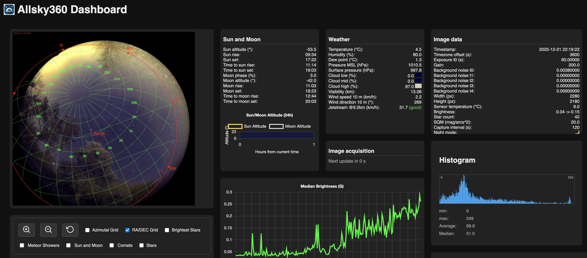
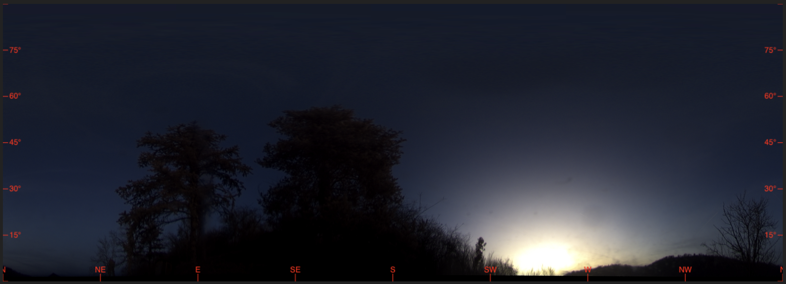

# Allsky360



Allsky360 turns an astronomy camera and a small Linux computer into an
**all-sky observatory station**. It captures the whole sky day and night,
fuses several exposures into one HDR image, and shows the live image, the
night's keogram, star trails, timelapse, weather and space weather in a web
interface. The image processing runs on the GPU (NVIDIA CUDA), so a Jetson
Orin board processes full-resolution HDR images in seconds.

The camera is controlled through [INDIGO](https://github.com/indigo-astronomy/indigo),
so every camera with an INDIGO driver (ZWO, Player One, QHY, Touptek, …) can
be used.


<!-- TODO: add a screenshot of dashboard.html and night.html (docs/images/) -->

---

## Features

**Capture and image processing**
- Continuous capture with automatic exposure and gain, separate day and night
  settings, switching by sun altitude
- HDR with up to 5 bracketed exposures, fused by multi-scale exposure fusion
- GPU pipeline: white balance, light-pollution (SCNR) and noise reduction,
  wavelet sharpening, local contrast, dehaze, tone curve, saturation
- Sky quality (SQM) estimate from the detected stars, focus measurement
- Horizon panorama, thumbnails, text overlay with station time

**Every night, automatically**
- Timelapse video (GPU JPEG decoding, H.264)
- Keogram and star trails
- Archive with automatic clean-up by age and disk size

**Station data**
- Weather and 24 h forecast from Open-Meteo
- Aurora and space weather (Kp, solar wind) from NOAA
- *Optional:* own weather station via RS485/Modbus sensors (temperature,
  humidity, pressure, wind, rain, cabinet climate)
- *Optional:* telescope mount position from INDIGO as overlay
- *Optional:* aircraft (ADS-B via dump1090)
- *Optional:* AI sky classification (clear, cloudy, …) with Ultralytics YOLO

**Web interface and API**
- Live image, dashboard with sun/moon/star overlays, archive, videos, night
  view, weather, aurora, camera statistics, system status and configuration
- Start, stop and restart the services from the browser (protected by token)
- All times shown in the station time zone or UTC
- REST API for your own pages and scripts

---

## What you need

| | Recommended | Also works |
|---|---|---|
| **Computer** | NVIDIA Jetson Orin Nano / Orin NX with JetPack 7.2 (Ubuntu 24.04) | Linux PC with an NVIDIA GPU (CUDA); any Linux system with the CPU-only build (much slower) |
| **Camera** | Color astronomy camera with an INDIGO driver and a fisheye lens (e.g. Player One Uranus-C, Saturn-C) | Monochrome cameras |
| **INDIGO server** | On the same computer | On another computer in the network |
| **Storage** | SSD/NVMe, 100 GB or more for the archive | SD card (short archive only) |
| **Network** | LAN or WLAN for the web interface | – |

Optional hardware is only needed for the matching feature: RS485 sensors and
an RS485 adapter, a mount with INDIGO driver, an ADS-B receiver.

---

## Quick start

1. **Install and start the INDIGO server** – see
   [INSTALL.md](INSTALL.md#installing-the-indigo-server). Clone INDIGO
   next to allsky360 (`~/indigo` and `~/allsky360`).
2. **Install Allsky360:**

   ```bash
   git clone <allsky360 repository> ~/allsky360
   cd ~/allsky360
   sudo ./install.sh
   ```

   The script checks the system, installs the dependencies, builds and
   installs everything to `/opt/allsky360` and asks for location, INDIGO
   server, camera and mount. Nothing is started without your confirmation.
3. **Open the web interface:** `http://<hostname>:3000/`
4. **Check that everything runs:** the *System Status* page shows all services;
   `make log` shows the live log of the camera.

Details, options and the manual installation: [INSTALL.md](INSTALL.md).

---

## After the installation

The first image usually looks right with the defaults. To get the most out of
your station, work through these points:

1. **Location and time zone** – `location_*` in `/home/allskyuser/config.ini`,
   see [GENERAL_SETTINGS.md](GENERAL_SETTINGS.md).
2. **Camera** – exposure and gain limits, debayer algorithm, see
   [CAMERA_SETTINGS.md](CAMERA_SETTINGS.md) and
   [INDIGO_SETTINGS.md](INDIGO_SETTINGS.md).
3. **Day and night** – brightness targets and white balance, see
   [DAYTIME_NIGHTTIME_SETTINGS.md](DAYTIME_NIGHTTIME_SETTINGS.md).
4. **Image geometry** – zenith position, horizon radius and north angle on
   the *Camera → Calibration* page; overlays, keogram and SQM depend on it.
5. **Image look** – HDR and filters, see [HDR-FUSION.md](HDR-FUSION.md) and
   [POSTPROCESSING.md](POSTPROCESSING.md).
6. **Optional modules** – sensors, mount, AI, see [TOOLS.md](TOOLS.md) and
   [INSTALL.md](INSTALL.md).

Changes to `config.ini` take effect with the next image; the camera does not
need a restart. Every key is explained in the comments of
[`config.ini.default`](config.ini.default).

---

## Documentation

| Document | Content |
|---|---|
| [INSTALL.md](INSTALL.md) | Installation: INDIGO, `install.sh`, manual build, API token, AI |
| [GENERAL_SETTINGS.md](GENERAL_SETTINGS.md) | Location, capture interval |
| [INDIGO_SETTINGS.md](INDIGO_SETTINGS.md) | INDIGO server, camera and mount selection |
| [CAMERA_SETTINGS.md](CAMERA_SETTINGS.md) | Exposure, gain, debayering, binning |
| [DAYTIME_NIGHTTIME_SETTINGS.md](DAYTIME_NIGHTTIME_SETTINGS.md) | Day and night mode, auto-exposure, white balance |
| [HDR-FUSION.md](HDR-FUSION.md) | How the HDR exposures are captured and fused |
| [POSTPROCESSING.md](POSTPROCESSING.md) | The image processing pipeline and its settings |
| [TOOLS.md](TOOLS.md) | Companion tools: meteo, aurora, sensors, timelapse, keogram, star trails |
| [API.md](API.md) | REST API of the web server |
| [CHANGELOG.md](CHANGELOG.md) | What has changed |
| [CONTRIBUTING.md](CONTRIBUTING.md) | How to contribute |

---

## How it works

```
 Camera ──USB──► INDIGO server ──TCP 7624──► allsky360-camera
                                                 │  capture, HDR fusion,
                                                 │  GPU image pipeline
                                                 ▼
                     images/YYYYMMDD/*.jpg  +  database/database_YYYYMMDD.db
                                                 ▲
  allsky360-meteo (Open-Meteo)  ─────────────────┤
  allsky360-aurora (NOAA)       ─────────────────┤   systemd services
  allsky360-sensors (RS485)     ─────────────────┤   and timers
  allsky360-mount-position      ─────────────────┤
  endofnight.sh: timelapse, keogram, star trails ┘
                                                 │
                                                 ▼
                              allsky360-api (Node.js, port 3000)
                                                 │
                                                 ▼
                                   web browser / your own scripts
```

All data is stored in UTC (daily folders, databases, file names); the web
interface converts it to the station time zone for display.

---

## License

MIT License. See [LICENSE.md](LICENSE.md) for the details.

## Author

Copyright (c) 2025–2026 Sven Kreiensen
